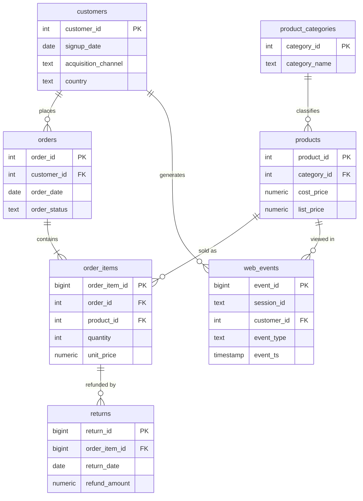

# E-commerce Analytics with PostgreSQL

Advanced SQL analytics on a realistic online-retail dataset — **revenue trends,
cohort retention, RFM segmentation, customer lifetime value, conversion-funnel,
product ABC/Pareto, market-basket, and churn analysis** — built and validated
end-to-end on PostgreSQL 16.

**Stack:** PostgreSQL 16 · advanced SQL (window functions, CTEs, `NTILE`,
`FILTER`, association-rule maths)

> Every query in this repo was executed against a live PostgreSQL database.
> The dataset is synthetic but behaviourally realistic (seasonality, growth,
> heavy-tailed customer value, channel-driven retention) so the analyses surface
> genuine, defensible findings rather than flat numbers. The CSVs are included in
> [`data/`](data/) — load them and run.

---

## Highlights — what the analysis found

A sample of the insights the queries produce on the generated data
(20,000 customers · 42,877 orders · 89,136 line items · 370,502 web events ·
$6.4M revenue over 2024–2025):

| # | Finding | Business implication |
|---|---------|----------------------|
| 1 | **Champions (RFM) are 25.8% of customers but 51.6% of revenue**; churned/hibernating are 24.6% of customers but 6% of revenue | Concentrate retention spend on the top quartile |
| 2 | **Biggest funnel leak is View → Add-to-Cart** (only 29.4% convert; 59.7% cart→checkout; 68.5% checkout→purchase) | The highest-ROI UX fix is the product/catalog page, not checkout |
| 3 | **Referral & Email customers retain at ~40% (3-mo) vs Social at ~25%**, and are worth ~70% more lifetime margin | Rebalance acquisition budget toward quality channels |
| 4 | **Electronics drives the most revenue (\$2.0M) at just 5.6% margin; Apparel earns 52% margin but loses 17.7% to returns** | Margin, not revenue, should steer merchandising |
| 5 | **Market-basket lift: Electronics+Accessories (1.44), Grocery+Health (1.27)** | Concrete bundle & "also-bought" opportunities |
| 6 | **33% of customers are churned (>180d), holding \$1.04M of historical revenue** | Quantified win-back opportunity |
| 7 | **Purchase gaps shrink with tenure: 111 days (1st→2nd order) → 45 days (5th→6th)** | Engaged customers accelerate; nurture early repeats |

Full numeric output for every analysis is in [`results/sample_results.md`](results/sample_results.md).

---

## Dataset & schema

Six tables modelling an online retailer over two years (Jan 2024 – Dec 2025).
The model is a clean star: `order_items` is the money grain, surrounded by
customer, product and category dimensions, plus a `web_events` clickstream (for
funnel analysis) and a `returns` table (for return-rate and net-revenue analysis).



**Design choices that matter for correct analytics:**
- `unit_price` is stored on the line item (the price *actually paid*), not looked
  up from the catalog — real prices change over time.
- `products.cost_price` lets every revenue query also report **margin**.
- `order_status` (`completed` / `cancelled` / `returned`) is handled explicitly:
  revenue excludes cancelled orders and nets off refunds.
- A `UNIQUE (order_id, product_id)` constraint keeps the line-item grain clean
  (duplicate SKUs in a cart merge into one line).

---

## The analyses

Each file is self-documenting: it opens with the **business question**, the **SQL
technique** used, and how to read the result.

| File | Business question | Headline technique |
|------|-------------------|--------------------|
| [`01_revenue_trends.sql`](sql/analysis/01_revenue_trends.sql) | How is revenue trending MoM/YoY, and what's the underlying trend? | `LAG`, running `SUM`, moving average (`ROWS BETWEEN`) |
| [`02_cohort_retention.sql`](sql/analysis/02_cohort_retention.sql) | Do customers come back? Which cohorts retain best? | Cohort grid via `FILTER`; triangular (NULL for un-elapsed months) |
| [`03_rfm_segmentation.sql`](sql/analysis/03_rfm_segmentation.sql) | Who are our best / at-risk customers? | `NTILE(5)` scoring + segment logic |
| [`04_customer_ltv.sql`](sql/analysis/04_customer_ltv.sql) | What is a customer worth, by channel? | Margin maths, AOV decomposition, cumulative LTV |
| [`05_funnel_conversion.sql`](sql/analysis/05_funnel_conversion.sql) | Where do we lose shoppers in the funnel? | Event-log → session state; step conversion with `LAG` |
| [`06_product_abc_pareto.sql`](sql/analysis/06_product_abc_pareto.sql) | Which products/categories actually drive the business? | Cumulative share window → A/B/C classes |
| [`07_market_basket.sql`](sql/analysis/07_market_basket.sql) | What gets bought together? | Self-join pairs; support / confidence / **lift** |
| [`08_retention_and_churn.sql`](sql/analysis/08_retention_and_churn.sql) | Who's churning, and how much revenue is at risk? | Recency buckets; inter-purchase gaps with `LAG` |

Supporting SQL: [`00_schema.sql`](sql/00_schema.sql) (DDL + indexes),
[`01_load_data.sql`](sql/01_load_data.sql) (bulk load),
[`02_data_quality_checks.sql`](sql/02_data_quality_checks.sql) (6 integrity
assertions run before any analysis).

---

## Selected result — RFM segmentation

```
        segment         | customers | pct_cust | revenue | pct_rev
------------------------+-----------+----------+---------+---------
 Champions              |      3307 |     25.8 | 3302554 |    51.6
 Loyal                  |      2760 |     21.5 | 1348430 |    21.1
 At Risk (was valuable) |       702 |      5.5 |  521904 |     8.1
 Needs Attention        |      1699 |     13.2 |  418098 |     6.5
 Hibernating / Churned  |      3156 |     24.6 |  382686 |     6.0
 Cannot Lose Them       |       347 |      2.7 |  232734 |     3.6
 New / Promising        |       861 |      6.7 |  199122 |     3.1
```

A quarter of customers drive over half of revenue — the classic signal that
retention of the top segment matters more than raw acquisition.

---

## How to run it

Requires PostgreSQL (14+). The dataset ships in [`data/`](data/), so there's
nothing to generate — just load and query. Run from the repo root:

```bash
# 1. create the database
createdb ecommerce

# 2. build schema, load data, run quality checks
psql -d ecommerce -f sql/00_schema.sql
psql -d ecommerce -f sql/01_load_data.sql
psql -d ecommerce -f sql/02_data_quality_checks.sql

# 3. run any analysis
psql -d ecommerce -f sql/analysis/03_rfm_segmentation.sql
```

Or run everything at once with `./run_all.sh`.

---

## SQL techniques demonstrated

- **Window functions** — `LAG`/`LEAD` (MoM, YoY, inter-purchase gaps), running
  `SUM` (cumulative revenue & LTV), moving averages (`ROWS BETWEEN … PRECEDING`),
  `NTILE` (RFM quintiles), `RANK`/`ROW_NUMBER`, `FIRST_VALUE`, partitioned shares.
- **Cohort analysis** — first-purchase cohorts, month-offset arithmetic, a
  correctly *triangular* retention grid (future cells are `NULL`, not zero).
- **Segmentation** — RFM scoring and named segments driving marketing action.
- **Association rules** — support, confidence and **lift** computed in pure SQL.
- **Funnel analytics** — collapsing an event log to per-session funnel state and
  measuring step-over-step drop-off.
- **Correct business semantics** — explicit order-status handling, revenue vs
  **margin** vs **net-of-returns**, and data-quality assertions run before analysis.
- **Clean modelling** — star schema, enforced constraints, purposeful indexing.

## Repository structure

```
ecommerce-sql-analytics/
├── README.md
├── run_all.sh                # build + load + run every analysis
├── data/                     # dataset CSVs (ready to load)
├── sql/
│   ├── 00_schema.sql         # DDL: tables, constraints, indexes
│   ├── 01_load_data.sql      # bulk load (\copy)
│   ├── 02_data_quality_checks.sql
│   └── analysis/             # 8 business-question-driven analysis scripts
└── results/
    └── sample_results.md     # real output from every analysis
```

---

*Dataset is synthetic and generated for demonstration; it models realistic
behaviour but does not represent any real company.*
